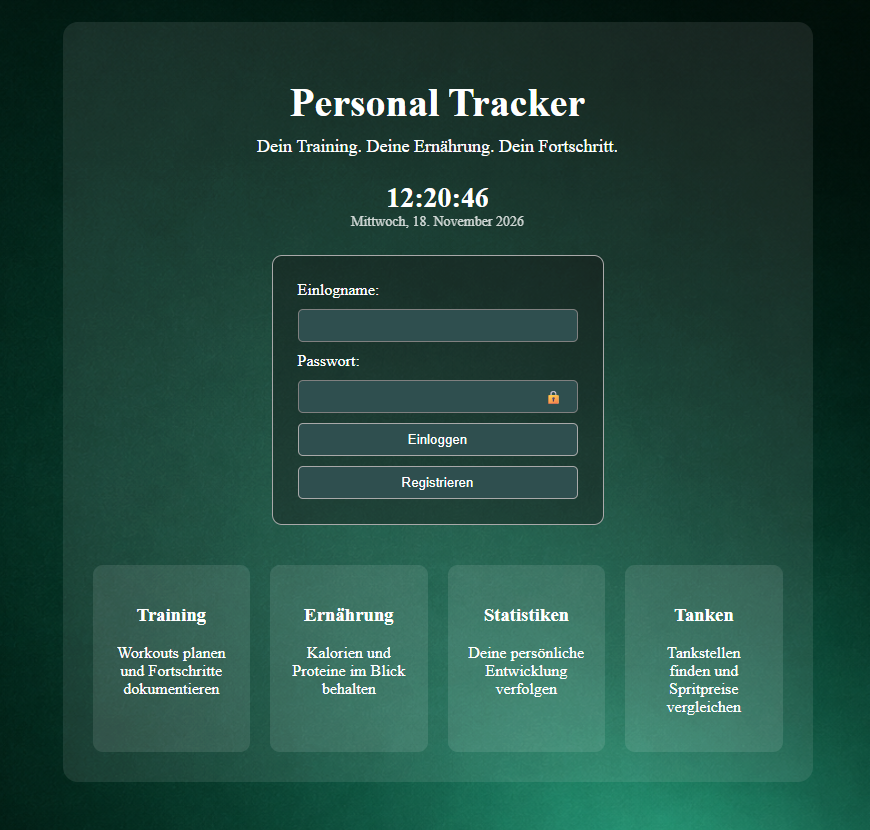
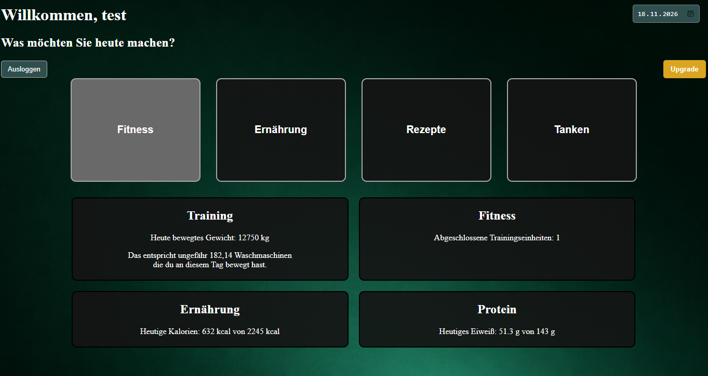
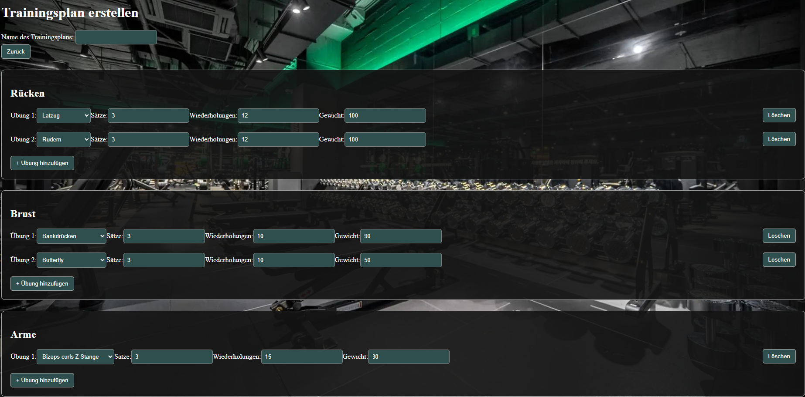
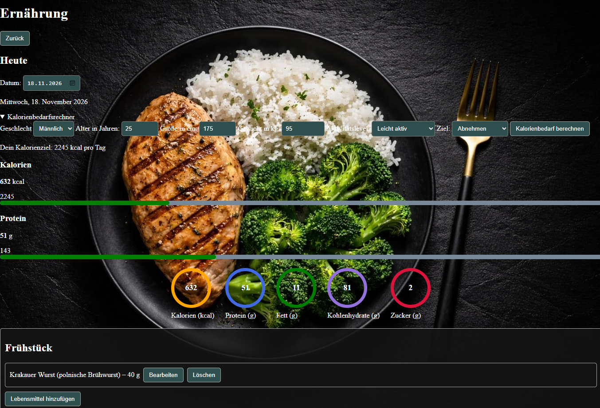
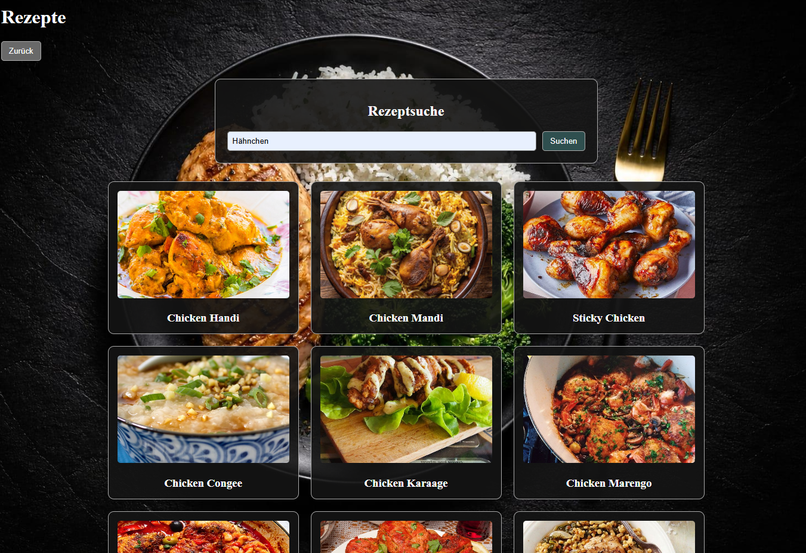
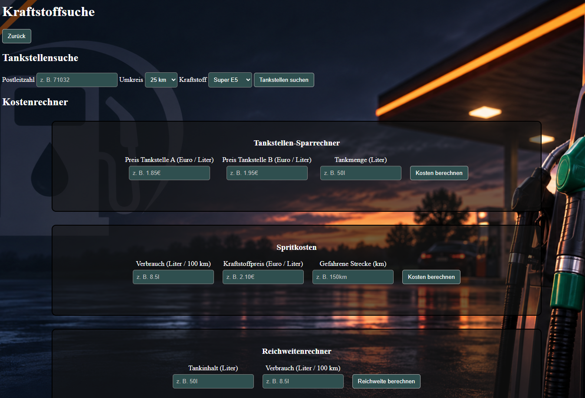

# Personal Tracker
Eine webbasierte Anwendung zur persönlichen Verwaltung von Fitness, Ernährung und weiteren Alltagsbereichen. 
Nutzer können ihre Trainings dokumentieren, Ernährung erfassen, Rezepte suchen und Tankstellenpreise vergleichen.

## Projektbeschreibung
Der Personal Tracker ist eine mit Python und Flask entwickelte Webanwendung. 
Die Anwendung bietet verschiedene Bereiche zur persönlichen Organisation und Dokumentation.
Die Daten werden lokal in SQLite-Datenbanken gespeichert. 
Der Zugriff auf die Anwendung erfolgt über ein Benutzerkonto mit unterschiedlichen Paketstufen.

## Screenshots

### Login

### Selection/Homepage

### Trainingspläne

### Ernährung

### Rezepte

### Tanken

## Funktionen
### Benutzerverwaltung
  - Registrierung und Login
  - Passwortgeschützte Benutzerkonten
  - Unterschiedliche Pakete: Basic, Premium und Premium+
  - Begrenzung der registrierten Benutzer
  - Verwaltung aktiver Benutzersitzungen

### Fitness und Workouts
  - Workouts erstellen und verwalten
  - Übungen und Gewichte dokumentieren
  - Gespeicherte Workouts absolvieren
  - Trainingszeit mit Timer erfassen
  - Abgeschlossene Trainingseinheiten speichern

### Ernährung
  - Lebensmittel suchen und hinzufügen
  - Kalorien und Nährwerte erfassen
  - Mahlzeiten dokumentieren
  - Kalorien- und Proteinziel berechnen
  - Vergangene Ernährungstage speichern
  - Eigene Lebensmittel erstellen und speichern

### Statistiken
  - Trainings- und Ernährungsdaten auswerten
  - Gewichtsverläufe vergleichen
  - Persönliche Fortschritte dokumentieren

### Rezepte
  - Lokale Rezeptsuche
  - Rezeptdetails anzeigen
  - Zutaten und Zubereitungsanleitungen abrufen
  - Übersetzung von Suchbegriffen von Deutsch auf Englisch
  - Übersetzung von Zutaten und Zubereitungsanleitungen von Englisch auf Deutsch

### Tanken und Spritrechner
  - Tankstellen nach Postleitzahl suchen
  - Kraftstoffarten E5, E10 und Diesel auswählen
  - Tankstellen nach Preis und Entfernung vergleichen
  - Fahrtkosten berechnen
  - Tankkosten vergleichen und Einsparungen berechnen

## Technologien
- Python
- Flask
- SQLite
- HTML
- CSS
- JavaScript
- REST-APIs

## Installation
1. Repository herunterladen oder klonen
2. Benötigte Python-Pakete installieren
3. Die erforderlichen Umgebungsvariablen konfigurieren
4. Datenbanken initialisieren
5. Flask-Anwendung starten

## Verwendung
Nach dem Start der Anwendung kann die Website über den Browser aufgerufen werden.
Für die Nutzung der Funktionen ist eine Registrierung und Anmeldung erforderlich.
Die verfügbaren Funktionen richten sich nach dem ausgewählten Benutzerpaket.

## Projektstruktur
Die Anwendung ist in Python-Routen, Datenbankfunktionen, HTML-Vorlagen, CSS-Dateien und JavaScript-Dateien aufgeteilt.
Die Datenhaltung erfolgt über separate SQLite-Datenbanken.

## Datenbank
Für die Speicherung der Anwendungsdaten wird SQLite verwendet.

Die Datenbanken enthalten unter anderem:
  - Benutzerkonten und Paketinformationen
  - Aktive Benutzersitzungen
  - Workouts und Übungen
  - Abgeschlossene Trainingseinheiten
  - Ernährungseinträge und eigene Lebensmittel
  - Rezeptdaten

## Sicherheit
- Zufällig generierter Flask SECRET_KEY
- Speicherung des SECRET_KEY außerhalb des Projektverzeichnisses
- Passwortgeschützte Benutzerkonten
- Signierte Flask-Sessions
- Individuelle Session-Tokens zur Verwaltung angemeldeter Benutzer
- Begrenzung auf maximal 8 registrierte Benutzer
- Begrenzung auf maximal 8 gleichzeitig aktive Benutzersitzungen
- Automatische Abmeldung nach 30 Minuten Inaktivität
- Begrenzung der Anmeldeversuche (Login-Rate-Limit)
- Serverseitige Eingabe- und Berechtigungsprüfungen

## Qualitätssicherung (QA)
- Erstellung einer dokumentierten Testsammlung
- Durchführung von Funktionstests für die verschiedenen Anwendungsbereiche
- Durchführung von Sicherheitstests für Login, Sessions und Zugriffsschutz
- Überprüfung von Eingaben, Berechtigungen und Datenbankzugriffen
- Dokumentation der Testergebnisse

## Externe APIs
### Open Food Facts

Verwendung für die Suche nach Lebensmitteln und den Abruf von Nährwertinformationen

Quelle: https://world.openfoodfacts.org/

### TankPuls

Verwendung für die Suche nach Tankstellen und den Abruf aktueller Kraftstoffpreise

- Verwendung: Suche nach Tankstellen anhand der Postleitzahl und Abruf aktueller Kraftstoffpreise
- Verwendung eines anonymen API-Schlüssels
- Die Preisdaten stammen aus der MTS-K(Sie werden über Tankerkönig bezogen)
- Die Preisdaten stehen unter CC BY 4.0
- Quelle: https://www.tankpuls.de/

### TheMealDB

Verwendung für Rezeptbilder und externe Rezeptinformationen
- Abruf externer Rezeptinformationen
- Abruf passender Rezeptbilder
- Übersetzung der Rezeptsuche und Rezeptinhalte
- Verwendung des kostenlosen öffentlichen Test-API-Keys
- API-Dokumentation: https://www.themealdb.com/api.php
- Quelle: https://www.themealdb.com/

### Rezeptdatenbank
Die lokale Rezeptdatenbank basiert auf dem Projekt [recipe-dataset](https://github.com/josephrmartinez/recipe-dataset).

- Umfang: ca. 13.000 Rezepte
- Lizenz: [CC BY-SA 3.0](https://creativecommons.org/licenses/by-sa/3.0/)
- Enthaltene Daten: Rezeptnamen, Zutaten und Zubereitungsanleitungen
- Ursprüngliche Quelle der Rezeptinhalte: Epicurious

Die Rezeptdaten werden für die lokale Rezeptsuche im Personal Tracker verwendet.

Quelle und Aufbereitung: [Joseph Martinez – recipe-dataset](https://github.com/josephrmartinez/recipe-dataset)